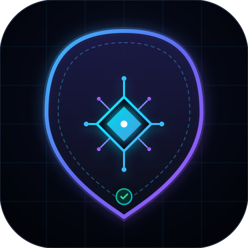

<p align="center">
  
</p>

<h1 align="center">AgentGuard</h1>

<p align="center">
  <strong>The Enterprise-Grade AI Sentinel &amp; Execution Shield for Autonomous Coding Agents</strong><br />
  <em>Prevents AI Dependency Hallucinations, Destructive Shell Execution, Cognitive Loops, Shadow Diffs, Secret Leaks, and Indirect Prompt Injections.</em>
</p>

<p align="center">
  <a href="https://opensource.org/licenses/Apache-2.0"></a>
  <a href="https://www.npmjs.com/package/@francaroscillidev/agentguard"></a>
  <a href="https://www.typescriptlang.org/"></a>
  <a href="https://sarifweb.azurewebsites.net"></a>
  <a href="https://modelcontextprotocol.io"></a>
</p>

---

## 💥 The Critical Unsolved Problems in AI Coding

Autonomous AI Coding Agents (Claude Code, Cursor, Antigravity, Devin, Copilot Workspace) introduce dangerous failure modes that completely bypass traditional linters (ESLint, Prettier, SonarQube):

1. **AI Dependency Hallucination / Package Squatting:**
   Agents invent non-existent libraries across npm, PyPI, Crates.io, and Go, opening repositories to supply chain poisoning.
2. **Destructive Shell Execution:**
   Agents executing autonomous shell commands can run catastrophic actions (`rm -rf /`, `curl | bash`, `chmod 777`, reverse shells).
3. **Cognitive Infinite Loops:**
   Agents get caught in endless circular iterations (e.g. failing a test -> editing the test incorrectly -> retrying endlessly).
4. **Shadow Diff Tampering:**
   During long refactoring sessions, agents may introduce stealthy unprompted network calls, telemetry, or prototype pollution.
5. **Indirect Prompt Injections & Jailbreaks:**
   Malicious instructions hidden in comments or third-party READMEs hijack the agent's behavior.
6. **Hardcoded Secrets & API Keys:**
   Accidental exposure of real tokens (`sk-...`, GitHub PATs, AWS credentials).

---

## ⚡ What AgentGuard v2.0.0 Delivers

* 🛡️ **Execution Shield (`agentguard shield-exec` & `shield_command` MCP):**
  - Intercepts shell tool-calls in runtime and blocks destructive commands with safe alternatives.
* 🔄 **Cognitive Loop Breaker (`check_cognitive_loop` MCP):**
  - Detects repetitive circular failure loops and prompts the agent or developer to halt execution.
* 📊 **Industry-Standard SARIF 2.1.0 Export (`--format sarif`):**
  - Native integration with **GitHub Advanced Security / Code Scanning tab** and GitLab SAST.
* 🎖️ **AI Compliance & Hygiene Scoring (Tier A+ to F):**
  - Evaluates codebases with an objective 0–100 score across Supply Chain, Secrets, Injections, and Code Smells.
* 🕵️ **Shadow Diff Inspector (`inspect_shadow_diff`):**
  - Audits Git diff patches to catch unrequested telemetry, network connections, or prototype pollution.
* 🎯 **Indirect Prompt Injection Defense (`scan-injections`):**
  - Scans files for hidden jailbreaks and instruction overrides.
* 🔧 **Automated Code Smell Fixer (`agentguard fix`):**
  - Safely refactors lazy agent artifacts (replaces swallowed errors with logging, converts `@ts-ignore` to `@ts-expect-error`).
* ⚓ **Native Git Pre-Commit Hook (`agentguard install-hook`):**
  - Zero-overhead safeguard blocking commits containing secret leaks or hallucinated packages.

---

## 🚀 Quick Start

### Global / Local CLI
```bash
# Run directly with npx
npx @francaroscillidev/agentguard --help

# Or install globally
npm install -g @francaroscillidev/agentguard
```

### 1. Run Comprehensive Audit with SARIF or Markdown Export
```bash
# Terminal summary
agentguard audit

# Markdown report with Hygiene Score (ideal for PR comments)
agentguard audit --format markdown

# Standard SARIF 2.1.0 output for GitHub Code Scanning
agentguard audit --format sarif > agentguard.sarif
```

### 2. Shield Shell Commands from Destructive Agent Actions
```bash
agentguard shield-exec "rm -rf /"
# 🚨 COMMAND BLOCKED [CRITICAL RISK]!
# Reason: Destructive root or home recursive deletion detected.
```

### 3. Auto-Fix Lazy AI Code Smells
```bash
agentguard fix
```

### 4. Install Native Git Pre-Commit Hook
```bash
agentguard install-hook
```

---

## 🤖 MCP Server Integration

Add **AgentGuard** to your agent configuration (`claude_desktop_config.json`, Antigravity, or Cursor):

```json
{
  "mcpServers": {
    "agentguard": {
      "command": "npx",
      "args": ["-y", "@francaroscillidev/agentguard", "mcp"]
    }
  }
}
```

### Exposed MCP Tools for Agents:
- `verify_package`: Pre-flight check before installing dependencies.
- `shield_command`: Intercept and block destructive shell actions.
- `check_cognitive_loop`: Detect and break runaway infinite agent execution loops.
- `inspect_shadow_diff`: Catch stealthy unprompted additions in code patches.
- `detect_prompt_injections`: Protect against indirect prompt injection vectors.
- `audit_manifests`: Validate all project dependencies in bulk.
- `detect_secret_leaks`: Check for hardcoded credentials.
- `audit_code_smells`: Scan for swallowed exceptions and antipatterns.
- `autofix_smells`: Automatically refactor lazy agent code.
- `check_scope_drift`: Verify file changes match user prompt intent.

---

## 📬 Contact, Support & Commercial Inquiries

If you have questions, feedback, enterprise integration requests, or custom agent governance needs, feel free to reach out directly:

- **Lead Developer & Maintainer:** Franca Roscilli
- **Email:** [francaroscillidev@gmail.com](mailto:francaroscillidev@gmail.com)
- **GitHub:** [@francaroscillidev-gif](https://github.com/francaroscillidev-gif)
- **Bug Reports & Feature Requests:** [Open an issue on GitHub](https://github.com/francaroscillidev-gif/agentguard/issues)

---

## 📄 License

Apache License 2.0. Copyright (c) 2026 Franca Roscilli (https://github.com/francaroscillidev-gif).
Open-source and free for all developers and AI agent platforms.
